# BombLab 实验报告

> 本文根据本仓库已有汇编分析、实现和运行记录整理，不包含个人信息。使用了 AI 辅助分析汇编、实现求解器、运行测试及整理文字，尚需结合本人实际理解修改后提交。文中图片是汇编摘录、分析或真实命令日志的排版渲染图，不是直接截取终端窗口的原生截图；图片性质及原始记录见 [图片索引](images/README.md)。若课程严格要求原生截图，应补充终端截图。

## 一、实验目标与环境

实验目标是分析个人 `bomb` 的机器指令，从各关的输入检查、数据流与控制流恢复计算关系，并在 `defuser.c` 中实现适用于不同 `challenge` 的求解器，而不是保存某个 seed 的固定答案。

| 项目 | 本次使用情况 |
| --- | --- |
| 运行环境 | Windows 下的 WSL，Ubuntu-24.04 |
| 分析工具 | GDB、objdump |
| 编译与测试 | GCC、make、Python 3、`public_test.py` |
| 实现文件 | `defuser.c` |
| 图片目录 | `images/`，本文使用相对路径引用 |
| 已完成范围 | Phase 1–6 和 Honor 隐藏关 |

没有修改 `bomb`、测试程序和驱动程序。现有炸弹的 SHA256 为：

```text
b58c3e41854196c380068b58c024f62b8d3d82792a78ca53f4b5706171221359
```

### 1.1 分析方法

先反汇编关卡入口，确定输入字段数量和最终比较位置；再跟踪 helper 的参数、返回值及数据表，恢复公式；最后通过 GDB 的寄存器记录和实际炸弹运行交叉验证。

常用命令示例如下：

```sh
gdb ./bomb
```

进入 GDB 后逐条执行：

```gdb
set pagination off
disassemble phase_04
disassemble p4_walk
```

`disassemble` 用于静态查看指令，不会自动执行程序。动态验证时再设置断点、运行程序、检查参数并使用 `finish` 观察函数返回结果。

### 1.2 统一记号

下文 `C` 表示当前关卡的 64 位 `challenge`，不是 seed。驱动程序负责由 seed 生成每关的 challenge。

- `u32(x)`：取最低 32 位。
- `^`：按位异或；`&`：按位与；`>>`：无符号逻辑右移。
- 除明确标为 64 位的操作外，公式中的加、减、乘及中间结果按 `uint32_t` 计算，溢出后保留低 32 位。
- `rol32`、`ror32`：32 位循环左移、右移。
- AT&T 汇编的源操作数在前、目的操作数在后，例如 `mov %rdi,%rax` 表示将 rdi 的值复制到 rax。

## 二、Phase 1：函数调用与参数传递

### 2.1 输入与关键汇编

`phase_01` 要求输入一个无符号 32 位整数。入口解析成功后调用 `p1_compute`，将返回的 eax 与输入比较，使用 `sete %al` 给出是否通过的布尔结果。

`p1_compute` 把 challenge 分成若干部分，依次调用 `p1_step1`、`p1_step0` 和 `p1_step2`。关键 helper 指令为：

```asm
# p1_step0
lea    0xdc16(%rsi),%eax
xor    %edi,%eax

# p1_step1
sub    %esi,%edi
lea    0x7439(%rdi,%rdi,2),%eax

# p1_step2
xor    $0x27cf,%esi
lea    (%rsi,%rdi,2),%eax
```

这里 `lea` 直接计算地址表达式的数值，不读取该地址的内存。例如最后一条指令计算 `esi + 2*edi`。

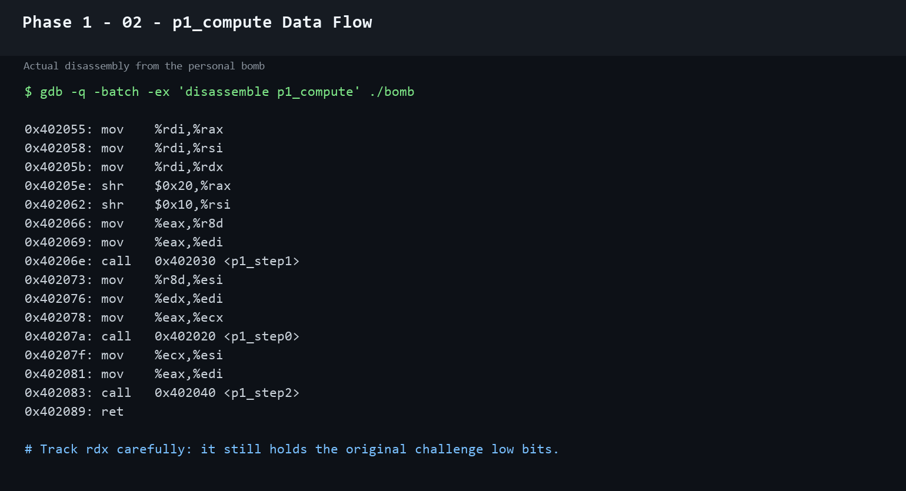

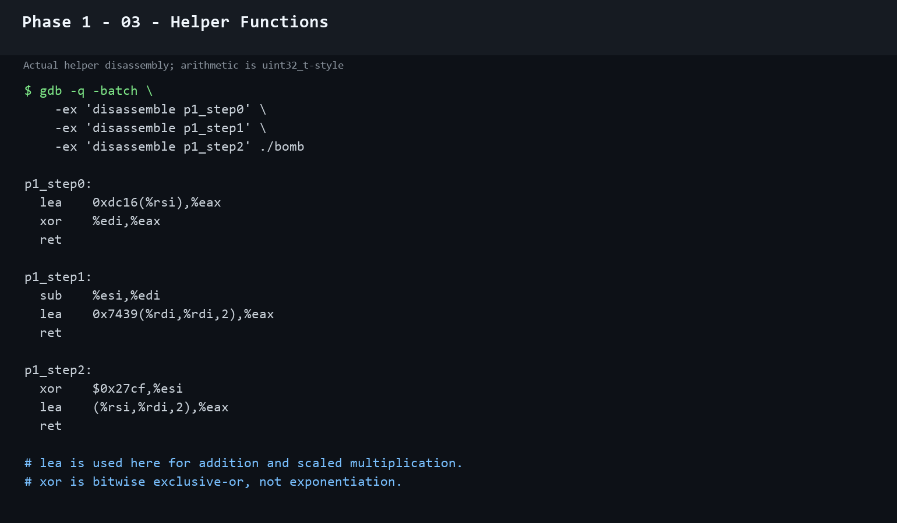

### 2.2 计算关系与推理

根据调用点的寄存器赋值恢复参数，记：

```text
H = u32(C >> 32)
M = u32(C >> 16)
L = u32(C)

t1 = 3*(H-M) + 0x7439
t0 = (H + 0xdc16) ^ L
answer = 2*t0 + (t1 ^ 0x27cf)
```

需要注意，`M` 虽然来自右移 16 位，但传入的是 32 位寄存器，因此它不是只取 16 位。推导时也不能把 helper 的第一个参数一直当成原始 challenge，要按照每个 `call` 前的赋值重新跟踪。

### 2.3 验证结果

| seed | challenge | 求解器输出 |
| --- | --- | --- |
| 42 | `0x28efe333b266f103` | `107068931` |
| 314159 | `0xd85dda4696932a2d` | `2548126079` |

十个公开 seed 均通过。`314159` 不在公开列表中，运行结果为 `Phase 1 defused.`。

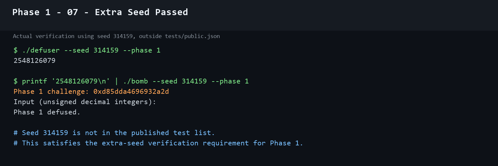

本关主要学习了参数寄存器、返回值寄存器和跨函数数据流的对应关系。

## 三、Phase 2：数组与循环递推

### 3.1 输入与关键汇编

本关要求六个无符号整数。第一项单独检查，随后循环检查五个后继元素。

首项计算包含 `shr $0x2e` 和 `and $0x3f`，分别对应右移 46 位及保留低 6 位。循环中的关键指令为：

```asm
lea    0x17(%rdx),%ecx
shr    %cl,%rax
and    $0xf,%eax
add    %edx,%eax
xor    %esi,%eax
lea    (%rax,%rax,2),%eax
```

rdx 是下标 `i`，`0x17` 为十进制 23，esi 在异或发生时保存前一项。数组寻址中比例因子为 4，与每项 4 字节对应。

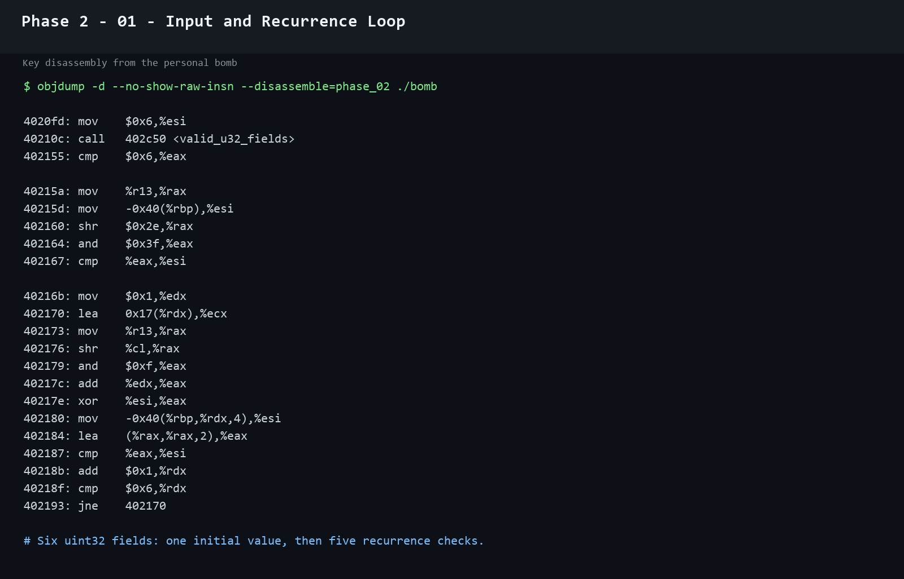

### 3.2 计算关系与推理

```text
v[0] = (C >> 46) & 0x3f

对 i = 1,2,3,4,5：
    part = (C >> (i+23)) & 0xf
    v[i] = 3*((part+i) ^ v[i-1])
```

循环每次只依赖 challenge、当前下标和上一项，因此可以按顺序生成六个数，不需要搜索。

seed 42 的逐项计算如下：

| i | part | 异或后的结果 | v[i] |
| --- | --- | --- | --- |
| 0 | 不适用 | 不适用 | 9 |
| 1 | 3 | `(3+1)^9 = 13` | 39 |
| 2 | 9 | `(9+2)^39 = 44` | 132 |
| 3 | 4 | `(4+3)^132 = 131` | 393 |
| 4 | 2 | `(2+4)^393 = 399` | 1197 |
| 5 | 1 | `(1+5)^1197 = 1195` | 3585 |

### 3.3 验证结果

seed 42 的答案为：

```text
9 39 132 393 1197 3585
```

列表外 seed `314159` 的 challenge 为 `0x049392bee0cdfbbd`，输出为：

```text
14 45 141 402 1158 3519
```

十个公开 seed 均通过，列表外验证输出 `Phase 2 defused.`。

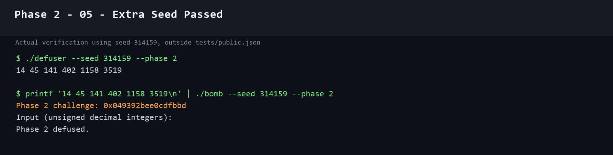

本关的关键是识别循环下标、数组步长，以及寄存器中“上一项”和“当前项”角色的变化。

## 四、Phase 3：switch 与跳转表

### 4.1 输入与关键汇编

本关要求两个整数。入口先计算并检查 selector：

```asm
and    $0x7,%edi
```

随后由 challenge 生成计算参数，并调用 `p3_dispatch`。dispatch 通过跳转表选择分支。表项是地址，不能把表的物理顺序、代码排列顺序或 `case_N` 名称直接当成 selector。

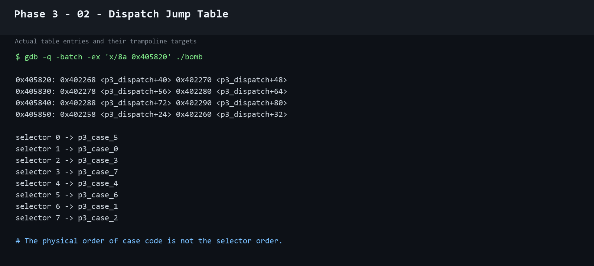

### 4.2 计算关系与推理

```text
s = C & 7
x = u32(C >> 32) ^ u32(C >> 3)
```

输入的第一个整数为 `s`，第二个整数按下表计算：

| s | 实际跳转目标 | 第二个整数 |
| --- | --- | --- |
| 0 | `p3_case_5` | `(4*x) ^ 0x2d8d` |
| 1 | `p3_case_0` | `(x ^ 0x90d2) + (x >> 1)` |
| 2 | `p3_case_3` | `5*x + 0x4c54a` |
| 3 | `p3_case_7` | `3*x + 0xe0d3` |
| 4 | `p3_case_4` | `5*x + 0xbf09` |
| 5 | `p3_case_6` | `(x ^ 0xad1c) + (x >> 1)` |
| 6 | `p3_case_1` | `3*x + 0x7808` |
| 7 | `p3_case_2` | `(4*x) ^ 0xaa22` |

seed 42：

```text
C = 0x581ce1ff0e4ae394
s = 4
x = 0xb9d5bd8d = 3117792653
第二个数 = u32(5*x + 0xbf09) = 2704110282
答案 = 4 2704110282
```

历史调试中曾用 `4 0` 观察真实返回值，因此产生过 `BOOM!!!`。这只说明占位答案不正确，不是最终求解器失败；本文使用后续真实通过的记录作为结果证据。

### 4.3 验证结果

十个公开 seed 均通过。列表外 seed `314159`：

```text
challenge = 0x1cd4d8174d7decfd
答案 = 5 1882815320
结果 = Phase 3 defused.
```

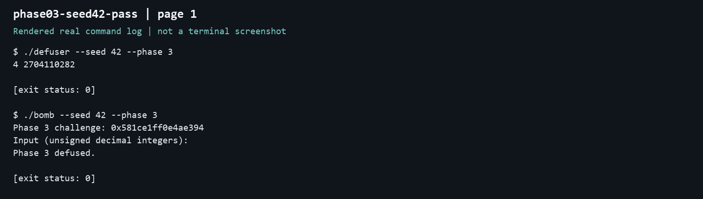


本关说明恢复 switch 时，必须把索引、表项、跳转目标和各分支公式完整对应起来。

## 五、Phase 4：递归调用与返回计算

### 5.1 输入与关键汇编

本关要求一个整数。`phase_04` 调用 `p4_walk` 前准备目标、区间与 key。递归函数先通过减法、右移和加法计算中点，再按相等、小于、大于分支执行。

命中分支与递归返回后的关键指令为：

```asm
# target == mid
lea    0x56(%rdi),%eax
xor    %ecx,%eax

# 递归子结果返回后
lea    (%rax,%rax,2),%eax
xor    %ebx,%eax

# 左分支结尾
xor    $0x1b,%eax

# 右分支结尾
xor    $0x6,%eax
```

因此函数不仅进行类似二分查找的定位，还会在返回时逐层计算结果。左右分支的常数不同。

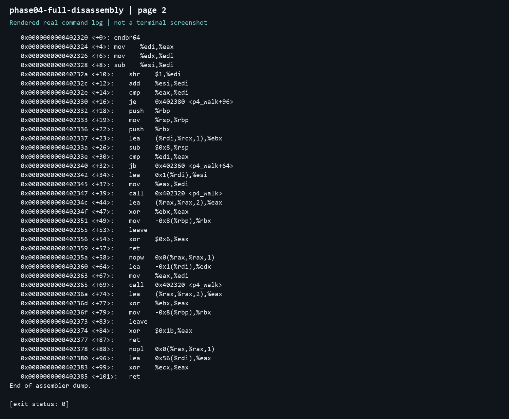

### 5.2 计算关系与推理

入口参数为：

```text
target = C & 127
lo = 0
hi = 127
key = u32(C >> 7) ^ u32(C >> 32)
```

恢复的递归关系为：

```text
W(target,lo,hi,key):
    mid = lo + ((hi-lo)>>1)
    如果 target == mid：
        return (mid+0x56) ^ key
    如果 target < mid：
        child = W(target,lo,mid-1,key)
        return (3*child) ^ (mid+key) ^ 0x1b
    否则：
        child = W(target,mid+1,hi,key)
        return (3*child) ^ (mid+key) ^ 0x06
```

seed 42 的 target 为 114，key 为 `0xbdf4c81d`。中点序列为：

```text
63 -> 95 -> 111 -> 119 -> 115 -> 113 -> 114
```

命中后要从最深一层反向计算，不能直接输出 114。GDB 使用 `finish` 观察最外层返回值，得到 `eax=0x55c143c5=1438729157`，与求解器输出一致。

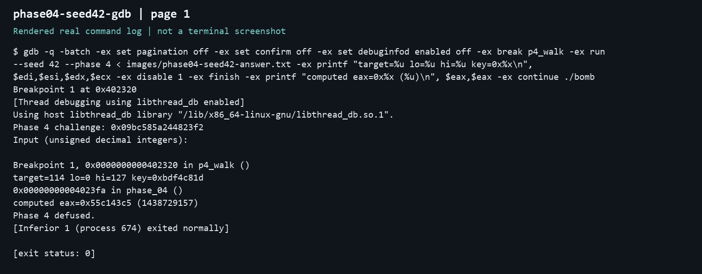

### 5.3 验证结果

十个公开 seed 的分关测试结果如下；完整原始日志见
[公开测试日志](images/all-public-tests.txt)。

| seed | 结果 |
| --- | --- |
| 0 | PASS |
| 1 | PASS |
| 7 | PASS |
| 42 | PASS |
| 99 | PASS |
| 123 | PASS |
| 2026 | PASS |
| 65535 | PASS |
| 987654321 | PASS |
| 18446744073709551615 | PASS |

因此 Phase 4 公开测试为 `10/10`。总公开测试记录见
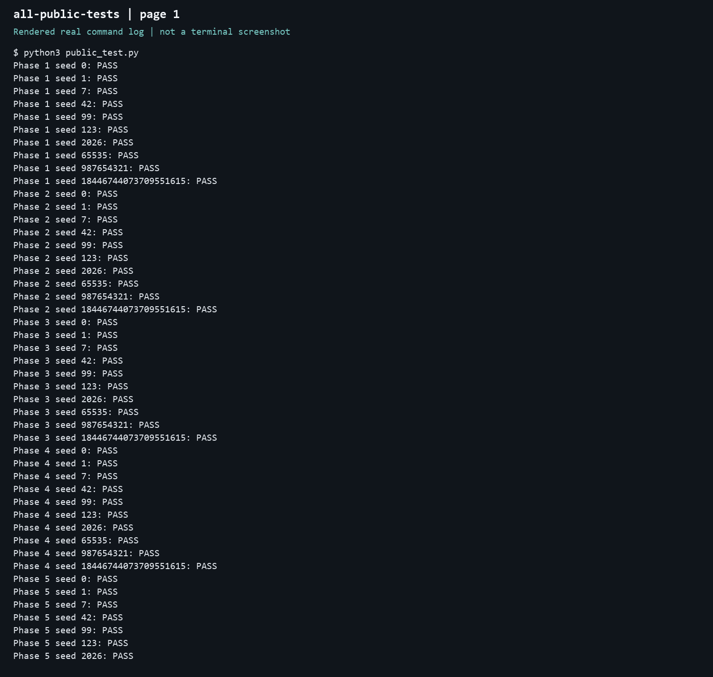。

列表外 seed `314159`：

```text
challenge = 0x6a9e8d40d5354fbc
答案 = 2497054073
结果 = Phase 4 defused.
```


本关主要学习递归参数的变化、终止条件以及调用栈展开后的返回计算。

## 六、Phase 5：结构体布局与链表遍历

### 6.1 输入与关键汇编

本关要求两个整数。通过 `p5_traverse` 的内存访问恢复节点字段：

```asm
mov    (%rdx),%rdx
mov    0x8(%rdx),%esi
xor    0xc(%rdx),%eax
```

对应布局为：

| 偏移 | 字段 | 大小 |
| --- | --- | --- |
| 0 | `next` 指针 | 8 字节 |
| 8 | `value` | 4 字节 |
| 12 | `tag` | 4 字节 |

节点数组的步长是 16 字节。`p5_heads` 保存八个起点指针，需要按照指针关系遍历，不能用节点在内存中的前后顺序代替 next。

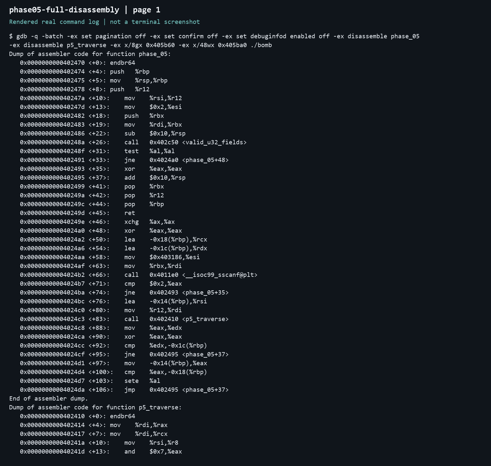

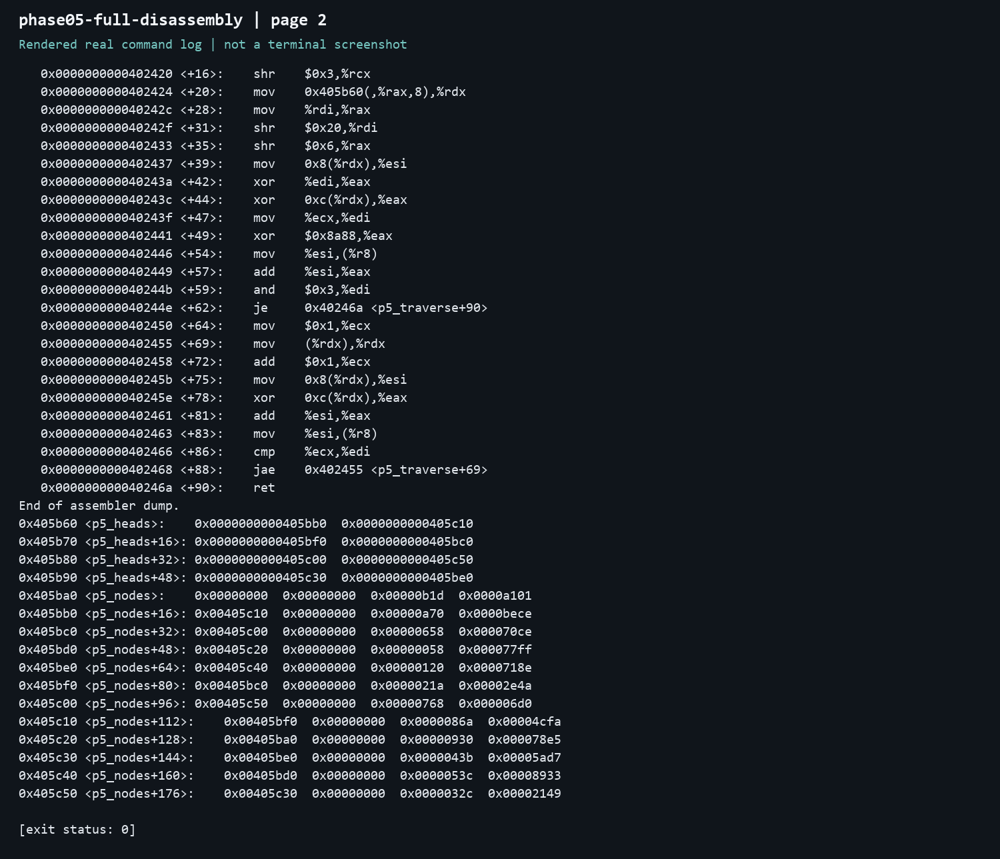

### 6.2 计算关系与推理

```text
node = heads[C & 7]
steps = (C >> 3) & 3
acc = u32(C >> 6) ^ u32(C >> 32) ^ 0x8a88

先处理首节点：
    acc = (acc ^ node.tag) + node.value
再沿 next 移动 steps 次：
    每次移动后，执行 acc = (acc ^ node.tag) + node.value

输出 acc 和最后处理的 node.value
```

汇编在判断是否进入后续循环之前，就已经处理了起点节点，所以总共处理 `steps+1` 个节点。首节点的 tag 必须参加异或，且顺序是先异或再加 value。

实现使用从当前二进制恢复的固定节点表；每次仍由 challenge 决定起点、步数和初始值，不是按 seed 写死答案。

seed 42：

```text
C = 0xde4431fa3c80db06
起点表索引 = 6
steps = 0
最后节点的 value = 0x43b = 1083
答案 = 917956356 1083
```

### 6.3 验证结果

十个公开 seed 的分关测试结果如下；完整原始日志见
[公开测试日志](images/all-public-tests.txt)。

| seed | 结果 |
| --- | --- |
| 0 | PASS |
| 1 | PASS |
| 7 | PASS |
| 42 | PASS |
| 99 | PASS |
| 123 | PASS |
| 2026 | PASS |
| 65535 | PASS |
| 987654321 | PASS |
| 18446744073709551615 | PASS |

因此 Phase 5 公开测试为 `10/10`。总公开测试记录见
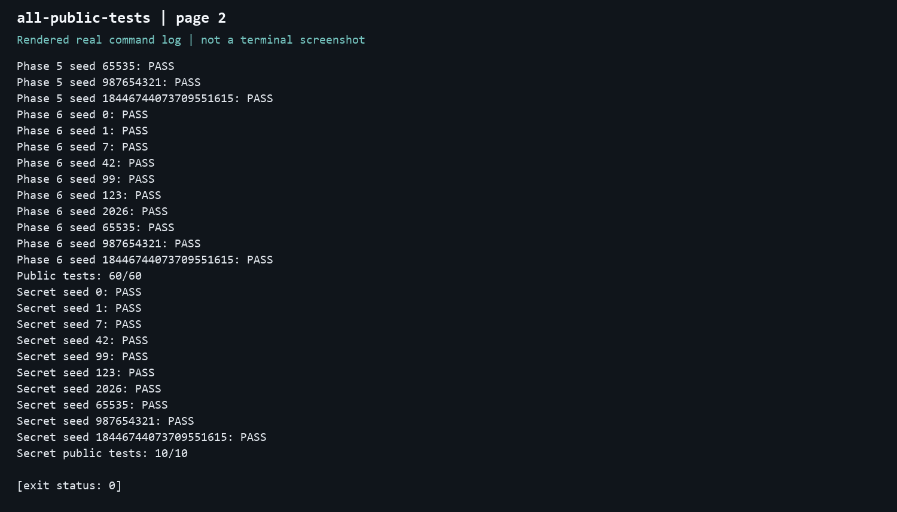。

列表外 seed `314159`：

```text
challenge = 0xd2b58ef282236824
答案 = 415078002 1896
结果 = Phase 5 defused.
```


本关重点是用字段偏移恢复结构体，并区分“移动次数”与“处理节点数”。

## 七、Phase 6：函数指针表与间接调用

### 7.1 输入与关键汇编

本关要求一个整数。`p6_dispatch` 中最关键的是两次间接调用：

```asm
call   *0x405e00(,%rax,8)
xor    $0x60e4,%eax
mov    %eax,%edi
call   *0x405e00(%rbx)
add    $0xe780,%eax
```

第一条调用从函数地址表中取出一个地址并执行。第二次调用前，ebx 已由 `challenge & 0x38` 得到，它是字节偏移，对应表索引 `(C >> 3) & 7`，不是直接取低三位。

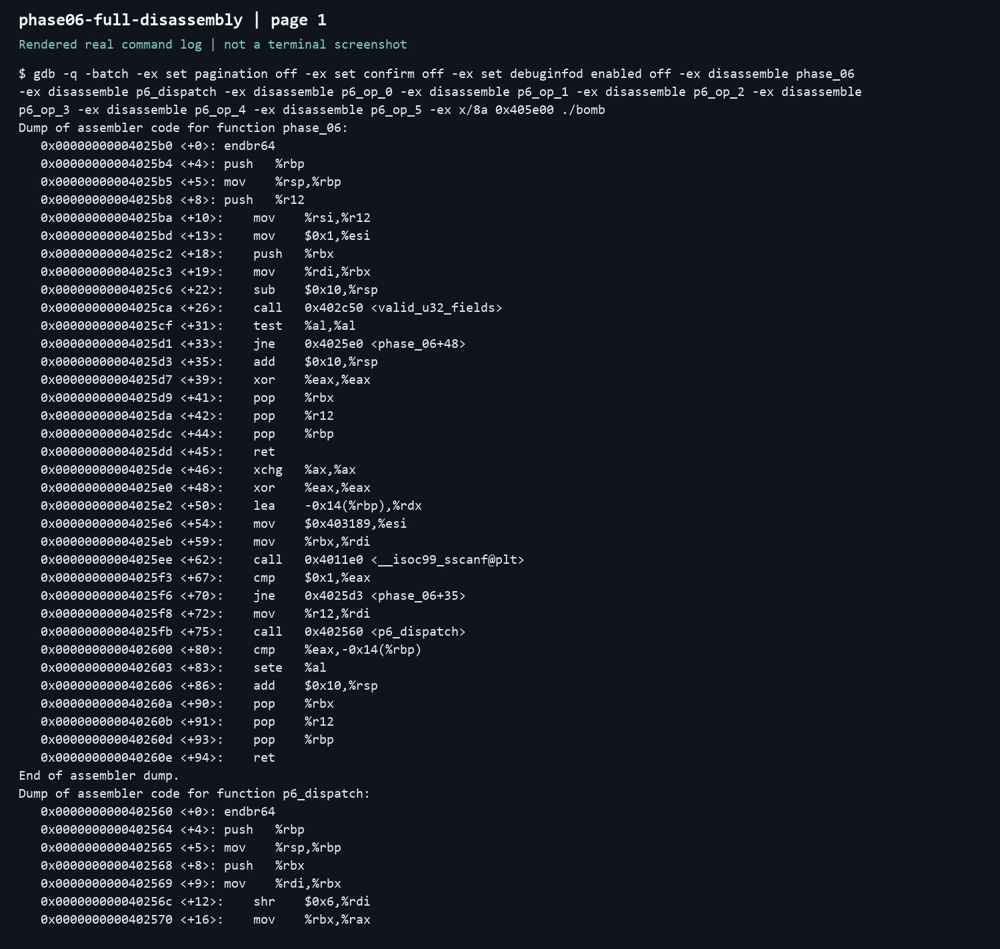

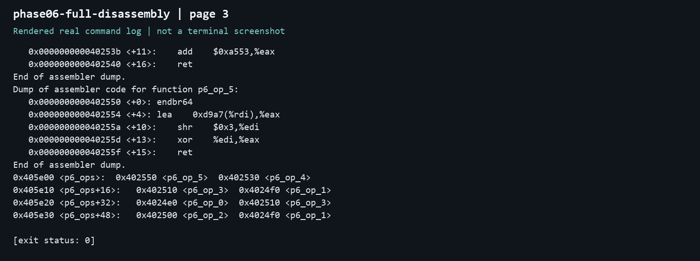

### 7.2 计算关系与推理

```text
x = u32(C >> 6) ^ u32(C >> 32)
i = C & 7
j = (C >> 3) & 7
answer = F[j](F[i](x) ^ 0x60e4) + 0xe780
```

真实表项顺序为：

```text
F[0..7] = [op5, op4, op3, op1, op0, op3, op2, op1]
```

同一函数可能在表中出现多次，各运算为：

| 函数 | 计算关系 |
| --- | --- |
| op0 | `rol32(x,5) ^ 0xd157` |
| op1 | `(x ^ 0xf304) + 8*x` |
| op2 | `ror32(x,5)` |
| op3 | `(4*x + 0x2c06) ^ (7*x)` |
| op4 | `(x ^ (x >> 2)) + 0xa553` |
| op5 | `(x + 0xd9a7) ^ (x >> 3)` |

循环移位必须保留从另一端回来的位，例如：

```text
rol32(x,5) = (x << 5) | (x >> 27)
ror32(x,5) = (x >> 5) | (x << 27)
```

seed 42 的 `C=0x37e9671c45376d5d`，`i=5,j=3`，即先调用 op3，再经异或调用 op1，最终结果为 `1128525277`。

### 7.3 验证结果

十个公开 seed 的分关测试结果如下；完整原始日志见
[公开测试日志](images/all-public-tests.txt)。

| seed | 结果 |
| --- | --- |
| 0 | PASS |
| 1 | PASS |
| 7 | PASS |
| 42 | PASS |
| 99 | PASS |
| 123 | PASS |
| 2026 | PASS |
| 65535 | PASS |
| 987654321 | PASS |
| 18446744073709551615 | PASS |

因此 Phase 6 公开测试为 `10/10`。总公开测试记录见
。

列表外 seed `314159`：

```text
challenge = 0xc1a32713817bbecc
答案 = 3388046429
结果 = Phase 6 defused.
```

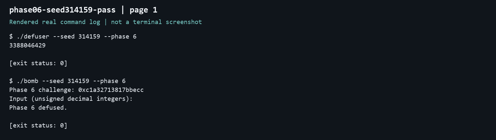

本关主要区分直接调用与间接调用，并把函数指针表中的真实顺序还原成完整的计算链。

## 八、Honor：输入布局与上下文相关校验

### 8.1 入口检查与关键汇编

隐藏关不是直接输入三个整数即可。`secret_gate` 先检查长度，再调用 `secret_copy`，检查指定位置的四个字符，最后把后续部分传给 `secret_phase`：

```asm
sub    $0x24,%rax
cmp    $0x7f,%rax
jbe    ...
call   secret_copy
cmpl   $0x4e45504f,-0xb0(%rbp)
lea    -0xac(%rbp),%rdi
call   secret_phase
```

长度检查对应允许 36 至 163 字节。复制区域从 `rbp-0xd0` 开始，字符检查位置为 `rbp-0xb0`，相差 32 字节；数字解析位置再向后 4 字节，即偏移 36。

x86 使用小端序，`0x4e45504f` 在内存中对应 `O P E N`。因此输出格式恢复为：

```text
[32 个填充字符]OPEN[s] [a] [b]
```

实现采用 32 个字符 `0` 作为填充，数字部分由 challenge 和 context 共同生成。

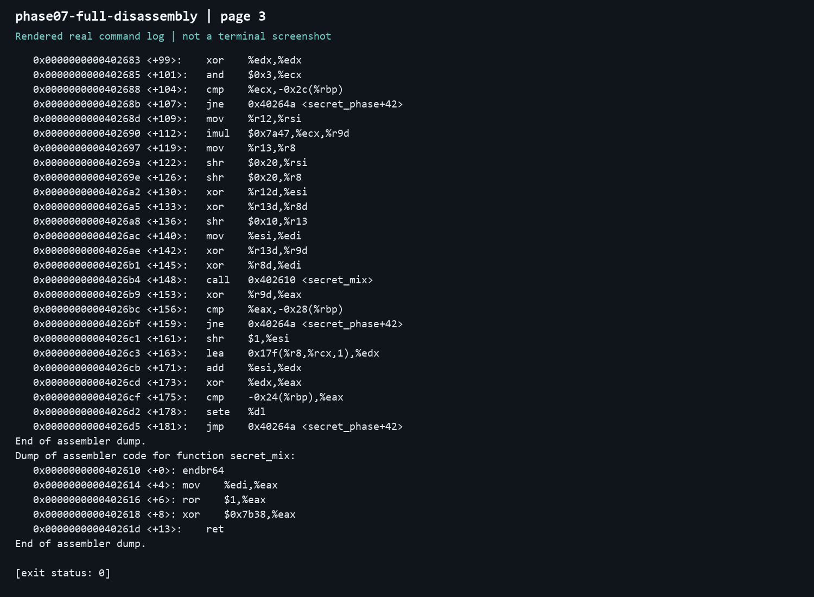

### 8.2 计算关系与推理

设 `T` 为驱动提供的 `context`。它由前六关答案的数值字段按顺序混合生成，不等于某一关的 challenge，也不能忽略。

```text
s = u32(T) & 3
f = u32(C) ^ u32(C >> 32)
h = u32(T) ^ u32(T >> 32)
x = f ^ h
a = ror32(x,1) ^ 0x7b38 ^ (s*0x7a47) ^ u32(T >> 16)
b = a ^ (h + s + 0x17f + (f >> 1))
```

`secret_phase` 首先验证第一个字段为 `s`，再分别验证 `a` 和 `b`。其中 `secret_mix` 的 `ror $1` 对应循环右移 1 位，而不是普通除以 2。

seed 42 的动态记录为：

```text
challenge = 0xccf635ee9e9e2fa4
context = 0x4cb4ff1ac438014f
偏移 32 的字符 = OPEN
偏移 36 的内容 = 3 308913114 2745741094
secret_phase bool result (al) = 1
```

此函数返回布尔值，成功标志应看 al，不应把 eax 中未用于返回值的高位误认为整个布尔结果。

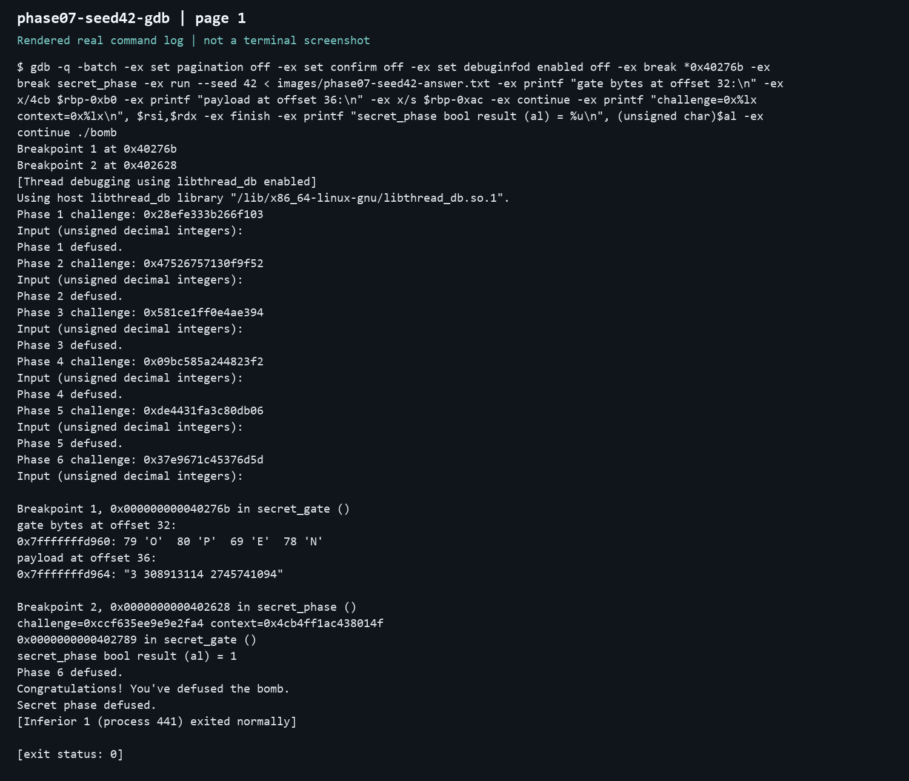

### 8.3 验证结果

十个公开 seed 均通过。列表外 seed `314159` 的隐藏关完整输入为：

```text
00000000000000000000000000000000OPEN0 1135859780 1139450892
```

运行时先输入六行常规关卡答案，再输入上面一行，最终输出：

```text
Congratulations! You've defused the bomb.
Secret phase defused.
```

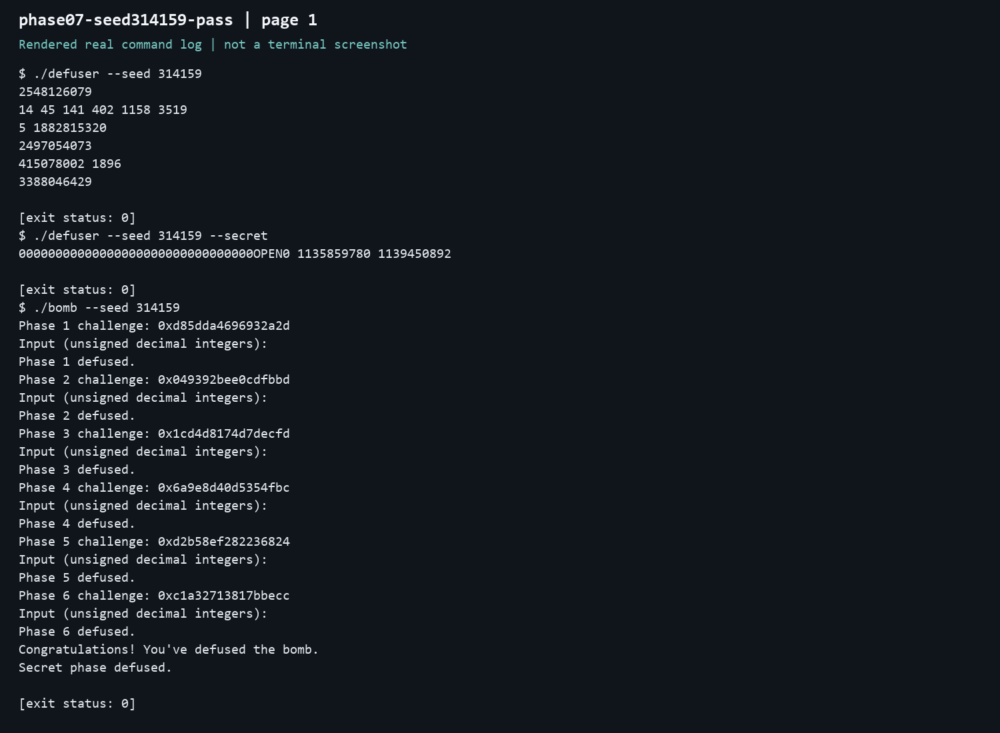

本关把栈上数据布局、小端序、复制逻辑和上下文计算联系起来，需要同时满足格式门槛和数值校验。

## 九、整体测试与复现

### 9.1 测试范围

以下结果来自已保存的实际运行记录，并非本次整理报告时重新执行的测试。

| 测试类别 | 范围 | 结果 |
| --- | --- | --- |
| 常规公开测试 | 六关，每关十个公开 seed | 60/60 |
| Honor 公开测试 | 十个公开 seed | 10/10 |
| 补充完整流程 | 321 个 seed，每次验证六关及 Honor | 321/321 |
| 定向 challenge 测试 | Phase 3–6，覆盖选择器和高位边界变化 | 696/696 |

补充完整流程中的 315 个 seed 不在公开列表中。每关均额外保留 seed `314159` 的通过图片，用于对应实验报告要求。

696 个定向测试的组成如下，每类均搭配三组不同高位模式：

| 关卡 | 低位覆盖范围 | 测试数 |
| --- | --- | --- |
| Phase 3 | 八个 selector | 24 |
| Phase 4 | 128 个 target | 384 |
| Phase 5 | 八个起点与四种步数 | 96 |
| Phase 6 | 两次索引的 64 种组合 | 192 |


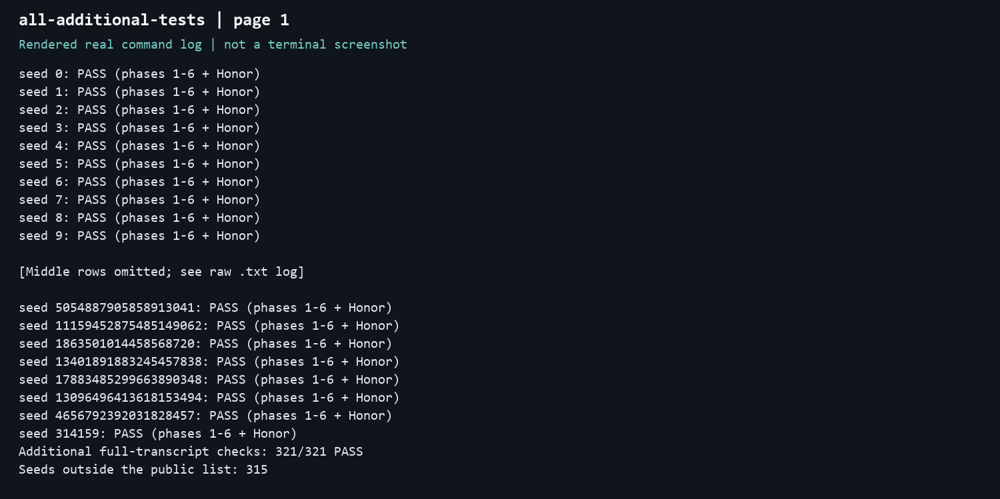

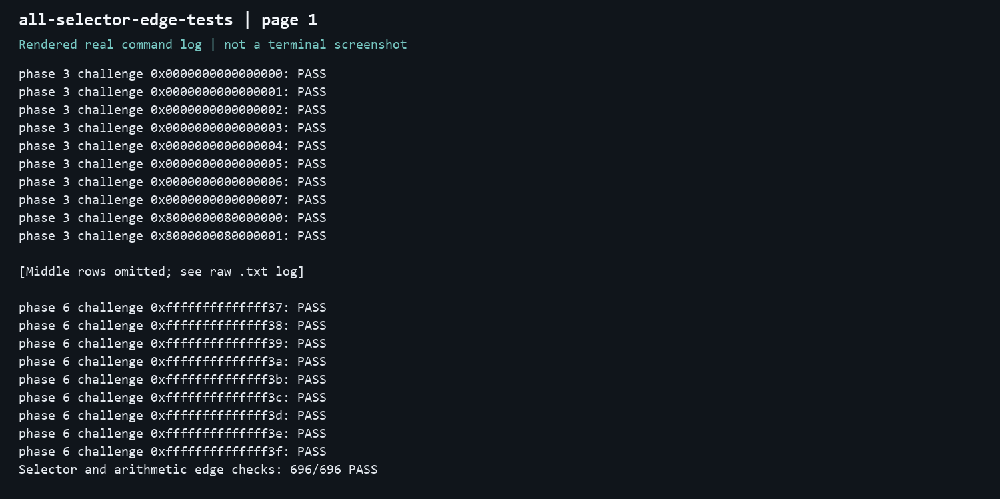

摘要图片省略了部分中间记录，完整文本分别见 [公开测试日志](images/all-public-tests.txt)、[补充测试日志](images/all-additional-tests.txt) 和 [定向测试日志](images/all-selector-edge-tests.txt)。测试通过说明当前覆盖范围内结果正确，不代表已运行助教全部隐藏测试。

### 9.2 复现命令

在 WSL 项目根目录执行：

```sh
make
python3 public_test.py
```

单独复现某一关，例如列表外 seed 的 Phase 4：

```sh
./defuser --seed 314159 --phase 4 | ./bomb --seed 314159 --phase 4
```

复现六关和 Honor：

```sh
{
    ./defuser --seed 314159
    ./defuser --seed 314159 --secret
} | ./bomb --seed 314159
```

`--secret` 只输出第七行，不能单独替代前六行。前六行和隐藏关必须使用一致的 seed。

## 十、易错点与阶段总结

本次分析中需要特别检查的地方包括：

1. 区分 64 位 challenge、右移后的值以及最终截断到 32 位的参数，避免丢失或额外保留位。
2. 区分 `lea` 的算术作用与实际访存，按指令顺序恢复异或、加法和乘法。
3. 跳转表、函数指针表都以实际表项为准，不能按照函数名猜索引。
4. 递归返回过程也参与计算；链表的首节点同样参与校验。
5. Honor 既有输入布局检查，也有 context 参与的数值检查。
6. 对二进制中的提示性或面向 AI 的字符串不直接采信，以真实执行路径和比较指令为依据。

各关的通用公式已实现到 `defuser.c`。报告初稿仍需结合个人实际学习情况补充理解过程，不应把 AI 生成内容表述为未经辅助的独立分析。

## 十一、参考材料与辅助工具声明

### 11.1 参考材料

本文依据本地材料整理，没有为生成初稿新增外部网络资料：

- [实验说明](README.md)：提交物、关卡知识点与报告要求。
- [图片索引](images/README.md)：图片用途、状态和原始记录说明。
- [Phase 3–7 分析笔记](phase3-7-notes.md)：恢复的公式与调试过程。
- `bomb` 的本地反汇编和 GDB 记录：判断实际程序行为的主要依据。
- `defuser.c`、`challenge.c`、`defuser_main.c`：求解实现、challenge/context 生成与输出协议。
- `tests/public.json`、`public_test.py`：公开 seed 列表和测试结果判定方式。

### 11.2 工具使用说明

GDB 和 objdump 用于观察汇编、内存及寄存器；GCC 和 make 用于编译；Python 脚本用于批量测试、保存日志，并通过 Pillow 把记录排版成图片。

本实验使用了 AI 编程助手，参与内容包括汇编讲解、计算关系恢复、求解器代码实现、测试执行、证据整理及报告初稿编写。本文不声明这些工作全部由个人独立完成。正式提交前应核对课程允许的工具使用范围，如实保留披露，按自己的实际理解修订正文，并将 `report.md` 和引用的 `images/` 图片一同提交。
